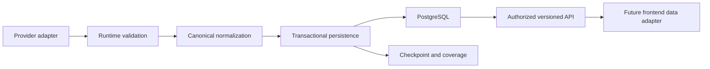
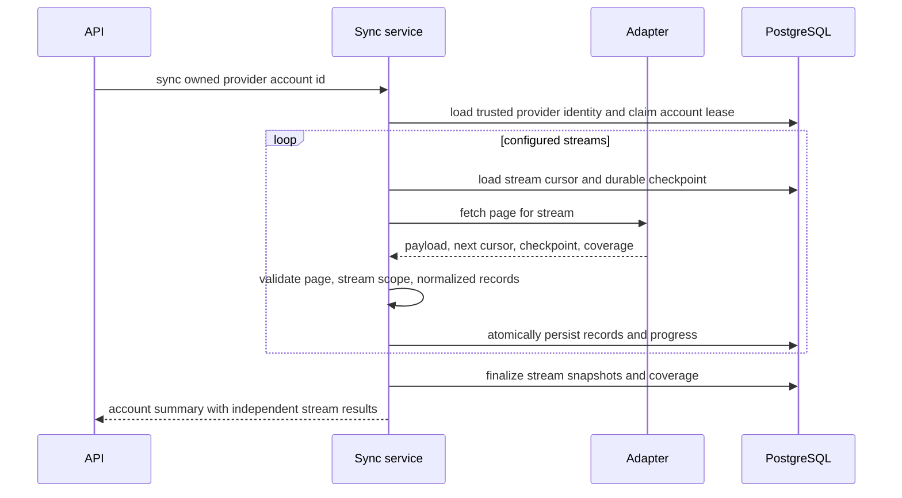

# Backend architecture

## Stack decisions

The backend is a TypeScript modular monolith. Fastify provides the HTTP lifecycle, request limits, JSON Schema validation, safe response serialization, and Pino logging. PostgreSQL stores canonical records and synchronization state. Drizzle supplies typed queries and versioned SQL migrations. Zod validates provider responses, and `decimal.js` validates decimal text before values reach PostgreSQL `NUMERIC(38,18)` columns.

Node.js 24 is pinned in CI and package metadata. Fastify 5 supports Node.js 20 and later. Fastify's schema validation operates on JSON Schema, and its logger supports redaction. Drizzle Kit generates SQL migrations that Drizzle applies from the migration folder. [Node.js releases](https://nodejs.org/en/about/previous-releases), [Fastify v5 migration guide](https://fastify.dev/docs/v5.8.x/Guides/Migration-Guide-V5/), [Fastify validation](https://fastify.dev/docs/latest/Reference/Validation-and-Serialization/), [Fastify logging](https://fastify.dev/docs/latest/Reference/Logging/), [Drizzle migrations](https://orm.drizzle.team/docs/migrations)

The stack keeps the existing TypeScript frontend on the same language and uses one relational database for ownership constraints and financial records. The current service does not calculate portfolio P&L. This avoids a competing accounting implementation while PR #1's `finance.ts` remains the source for frontend figures.

## Module boundaries

- `providers/` owns provider identity, capabilities, source parsing, and mapping to canonical records.
- `domain/` defines the normalized record union and exact decimal-string validation.
- `ingestion/` coordinates retries, account leases, page commits, source revisions, and coverage.
- `db/` owns PostgreSQL access, schema, and migration execution.
- `http/` owns the versioned API, request validation, principal resolution, ownership checks, and safe errors.

The configured registry contains `fixture-multisided` and `fixture-account-snapshot`. They use different source shapes and expose different capabilities. They are labeled fixtures throughout. No real provider adapter is configured.

## Canonical records

- A portfolio belongs to a user principal. Provider accounts are attached to portfolios and keep their provider-native account identifier separate from the principal.
- Provider events, markets, and outcome instruments keep provider-scoped external IDs. Markets can contain more than two outcomes. Cross-provider event relationships are stored separately with a review state that defaults to `unverified`.
- Fills, signed cash movements, settlements, positions, cash balances, and price observations are distinct records. Position snapshots identify whether the source reported them or they were reconstructed. Reconciliation state is retained.
- Source records keep an adapter-selected, validated payload, a SHA-256 digest, retrieval time, normalization version, and source revision time when available. Superseded financial versions and stale market observations are retained in `source_record_revisions` with a revision type.
- Coverage records are independent by provider account and entity. Observed record ranges do not imply that every record in the interval exists. Provider-confirmed coverage intervals and source freshness remain separate from observed record times and from the latest attempt/success timestamps.

The schema does not assume binary markets, a fixed settlement amount, a universal asset, or a complete provider transaction history. Instrument payout values and collateral codes remain provider data. Event relationships are not inferred from title similarity.

## Financial integrity

Monetary amounts, fees, quantities, prices, payouts, and balances use PostgreSQL `NUMERIC(38,18)`. Adapters pass decimal strings. The runtime validator accepts at most 20 significant integer digits and 18 nonzero fractional digits; excess trailing zeroes are allowed because they do not change the value. No financial value passes through JavaScript `number` during normalization. API serialization returns decimal strings so callers do not silently round values.

Fees have both a nullable amount and a status. `unavailable` requires a null amount. `reported` and `estimated` require an amount. Negative fee values can represent rebates. A missing mark remains null. Cash movements use signed amounts, with deposits positive and withdrawals negative. All persisted timestamps use `timestamp with time zone` and normalized UTC ISO values. Original timestamps remain in the sanitized source payload for audit and replay.

The API returns source facts and coverage. It does not infer missing deposits, fill prices, fees, marks, or settlement outcomes, and it does not present partial activity as lifetime performance.

## Synchronization and recovery

The service reloads provider code and external account ID from the owned database row; caller-supplied identity fields are not trusted. One account-wide database lease prevents overlapping syncs, while each configured stream has its own checkpoint and run history. The lease expires after two minutes and is renewed before each page and transaction. Requests time out after at most ten seconds, retryable provider errors retry once with bounded backoff, and each account request stops after 25 seconds.

Pagination cursor and durable provider checkpoint are different values. A committed page atomically stores its records, next pagination cursor, and any new durable checkpoint. An incomplete run resumes at the last committed cursor. Once a stream completes, its page cursor is cleared while its provider checkpoint is passed to the next incremental run. Repeated cursor transitions, pages beyond 100, pages beyond 500 records, and streams beyond 10,000 records are rejected or stopped with safe error codes.

Stable account-scoped external IDs and unique indexes make financial activity ingestion idempotent. A legitimate fill correction updates the canonical financial row and preserves its previous source version. Market records use provider `sourceUpdatedAt` when supplied: an older revision cannot replace newer event or market metadata, and its payload is kept as a stale observation. If the provider supplies no revision timestamp, retrieval order is the available fallback; that limitation remains provider-specific.

Coverage stores observed record range, provider-confirmed interval, provider source-as-of time, and attempt/success timestamps separately. Observed record ranges are updated in the same transaction as the page and never use an event's future resolution date. A range containing records does not imply continuous history. An empty result can be complete only when the provider reports complete coverage. Interrupted attempts update last-attempt fields but preserve established coverage; an incomplete first import is partial only when it committed pages. Unsupported operations remain unavailable with `unsupported_by_provider`; a provider can separately report temporary unavailability.

Position and cash snapshot observations are retained per sync run. Rows from a full authoritative snapshot are not published as current until every page succeeds and the provider reports complete coverage for that entity. Finalization replaces the prior current set, including clearing it for a complete empty snapshot. Partial snapshots leave the prior current set intact. Providers that expose incremental updates declare that contract and update only received instruments/assets; explicit zero positions close a holding, and older observations cannot replace newer current observations. Cash balances preserve explicit zero values. The API reads only rows marked current.

## API and ownership

The REST contract is versioned under `/v1` and published as OpenAPI at `/docs`. Fastify JSON Schema validates route parameters and pagination. SQL is built through Drizzle's parameterized query APIs. Every private query joins through the owning portfolio and the authenticated principal. Out-of-scope portfolios and accounts return the same 404 response as absent resources.

The current development principal is selected by server configuration after a bearer token check. The server never accepts an owner ID from the client. The fixed-token mechanism is unavailable in production, and the unimplemented external-auth mode fails closed. `GET /v1/providers` exposes only the configured adapter capability list. Other private routes require a bearer token.

## Security controls and remaining work

| Asset or boundary | Current control | Remaining work before production |
|---|---|---|
| Portfolio and account data | Principal-scoped database queries, UUID ownership links, private routes require bearer authentication | Integrate a maintained OIDC or equivalent principal resolver, user sessions, and security review |
| Development token | Constant-time digest comparison, token redaction, fixed principal from environment | Replace with production identity and managed secrets |
| Provider requests | Static adapter registry, central stream/record validation, bounded timeouts, no user-supplied fetch URL | Add provider-specific endpoint allowlists, rate handling, response-size enforcement, and upstream security review |
| Database records | Parameterized queries, foreign keys, unique external IDs, numeric checks, transactions | Separate migration and application roles, validate backup restoration, and configure managed encryption and rotation |
| HTTP service | 256 KB request body limit, 30 second request timeout, allowlisted CORS, 100 requests per minute globally, five sync requests per minute | Configure trusted proxy hops and production edge limits with the deployment platform |
| Logs and source payloads | Authorization header redaction, safe API errors, adapter-selected payload fields, sensitive-key rejection as defense in depth, 64 KB raw-record cap | Set production retention, access, audit, and data deletion procedures |

The local Compose service binds PostgreSQL to loopback. The app does not store provider credentials or expose trading operations. The repository does not yet have a production authentication provider, secret manager, deployed service, backup automation, or an end-user deletion endpoint. Deleting a user row cascades through that user's portfolio, provider accounts, source records, and financial data. Shared provider market metadata can remain after portfolio deletion.

## Local data operations

The Compose volume persists PostgreSQL data across container restarts. A local backup can be made with `docker compose exec -T postgres pg_dump -U scevia scevia > scevia-backup.sql`. Restore into a fresh local database with `cat scevia-backup.sql | docker compose exec -T postgres psql -U scevia -d scevia`.

Keep `.env` files and database backups out of Git. A production deployment must set an explicit retention period, restrict backup access, test restoration, and define deletion behavior before storing user-linked real provider data.

The test runner starts an isolated PGlite instance by default. An external destructive-test database requires an explicit opt-in, a loopback PostgreSQL host, and a database name ending in `_test`. Fixture seeding is blocked in production and limited to a local `scevia` or `scevia_test` database unless a developer explicitly allows a `_dev` target.

## Phase 2 Polymarket handoff

Reuse the provider registry, stream capability declarations, central page and normalized-record validation, `IngestionService`, transactional persistence, source revisions, entity coverage, snapshot lifecycle, and read-only API. Keep each Polymarket endpoint as a separate stream when it has different pagination, freshness, history, or snapshot guarantees. Provider-specific code should explicitly map only required payload fields before central validation.

Before implementation, verify against current official Polymarket documentation and sanitized real responses: endpoint authentication and rate limits; account identity and supported wallet types; pagination token lifetime and ordering; whether a durable cursor exists; fills/trades and fee fields; deposits, withdrawals, and transfers; settlement and redemption records; positions completeness and as-of time; market/outcome identifiers; and price source/timestamp semantics. Do not assume `sourceUpdatedAt`, event lifecycle, fee meaning, or history boundaries until confirmed from responses.

Likely model additions should be driven by evidence: transaction hash and log index, chain/network, provider confirmation/finality or reorg state, distinct deposit versus internal transfer identities, resolution payout versus redemption cash movement, source-specific fees, and provider ordering tokens. These fields are not yet verified as necessary for every Polymarket stream.

Require sanitized adapter contract fixtures for first/middle/final pages, repeated requests, empty complete responses, stale revisions, missing optional fields, provider corrections, and rate/timeout errors. Integration evidence should reconcile a known wallet's fills, positions, deposits/withdrawals, settlements, and current marks by source ID and exact decimal totals, with unexplained differences reported instead of forced away. Keep Phase 1 in progress until PR #3 is reviewed and merged; this handoff does not authorize production credentials or live deployment.
