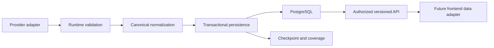
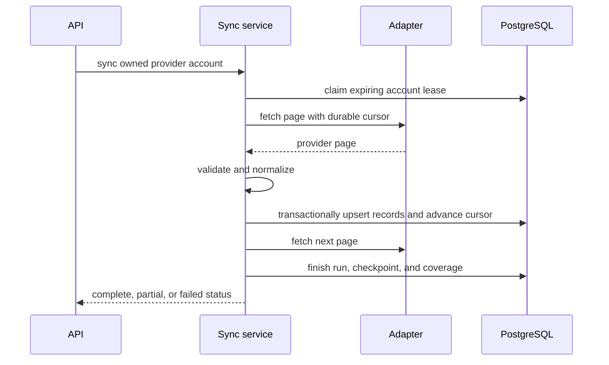

# Backend architecture

## Stack decisions

The backend is a TypeScript modular monolith. Fastify provides the HTTP lifecycle, request limits, JSON Schema validation, safe response serialization, and Pino logging. PostgreSQL stores canonical records and synchronization state. Drizzle supplies typed queries and versioned SQL migrations. Zod validates provider responses, and `decimal.js` validates decimal text before values reach PostgreSQL `NUMERIC(38,18)` columns.

Node.js 24 is pinned in CI and package metadata. Fastify 5 supports Node.js 20 and later. Fastify's schema validation operates on JSON Schema, and its logger supports redaction. Drizzle Kit generates SQL migrations that Drizzle applies from the migration folder. [Node.js releases](https://nodejs.org/en/about/previous-releases), [Fastify v5 migration guide](https://fastify.dev/docs/v5.8.x/Guides/Migration-Guide-V5/), [Fastify validation](https://fastify.dev/docs/latest/Reference/Validation-and-Serialization/), [Fastify logging](https://fastify.dev/docs/latest/Reference/Logging/), [Drizzle migrations](https://orm.drizzle.team/docs/migrations)

The stack keeps the existing TypeScript frontend on the same language and uses one relational database for ownership constraints and financial records. The current service does not calculate portfolio P&L. This avoids a competing accounting implementation while PR #1's `finance.ts` remains the source for frontend figures.

## Module boundaries

- `providers/` owns provider identity, capabilities, source parsing, and mapping to canonical records.
- `domain/` defines the normalized record union and exact decimal-string validation.
- `ingestion/` coordinates retries, account leases, page commits, source revisions, and coverage.
- `db/` owns PostgreSQL access, schema, and migration execution.
- `http/` owns the versioned API, request validation, principal resolution, ownership checks, and safe errors.

The configured registry contains `fixture-multisided` and `fixture-account-snapshot`. They use different source shapes and expose different capabilities. They are labeled fixtures throughout. No real provider adapter is configured.

## Canonical records

- A portfolio belongs to a user principal. Provider accounts are attached to portfolios and keep their provider-native account identifier separate from the principal.
- Provider events, markets, and outcome instruments keep provider-scoped external IDs. Markets can contain more than two outcomes. Cross-provider event relationships are stored separately with a review state that defaults to `unverified`.
- Fills, signed cash movements, settlements, positions, cash balances, and price observations are distinct records. Position snapshots identify whether the source reported them or they were reconstructed. Reconciliation state is retained.
- Source records keep a validated, minimized payload, a SHA-256 digest, retrieval time, and normalization version. When a source record changes, its prior payload version is retained in `source_record_revisions`.
- Coverage records describe supported, partial, unavailable, and unknown data by provider account and entity type. Unsupported capabilities are marked unavailable with `unsupported_by_provider`.

The schema does not assume binary markets, a fixed settlement amount, a universal asset, or a complete provider transaction history. Instrument payout values and collateral codes remain provider data. Event relationships are not inferred from title similarity.

## Financial integrity

Monetary amounts, fees, quantities, prices, payouts, and balances use PostgreSQL `NUMERIC(38,18)`. Adapters pass decimal strings. The runtime validator rejects floating-point input in the normalized model. API serialization returns decimal strings so callers do not silently round values through JavaScript `number`.

Fees have both a nullable amount and a status. `unavailable` requires a null amount. `reported` and `estimated` require an amount. Negative fee values can represent rebates. A missing mark remains null. Cash movements use signed amounts, with deposits positive and withdrawals negative. All persisted timestamps use `timestamp with time zone` and normalized UTC ISO values. Original timestamps remain in the sanitized source payload for audit and replay.

The API returns source facts and coverage. It does not infer missing deposits, fill prices, fees, marks, or settlement outcomes, and it does not present partial activity as lifetime performance.

## Synchronization and recovery

Each provider account has a database-backed lease. A second sync receives a conflict while the lease is active. The lease expires after two minutes and is renewed before each page. Requests time out after ten seconds, retryable provider errors retry once with bounded backoff, and a run stops after 100 pages.

A page's normalized data and its next cursor commit in one transaction. A later page failure leaves the cursor at the last committed page and marks the run partial. The next sync resumes there. A lease acquired after expiry marks any abandoned running job as interrupted. Stable account-scoped external IDs and unique indexes make repeated syncs idempotent. Source corrections update the canonical record and preserve the previous sanitized source version.

Coverage is written in the same transaction that finalizes the run. A successful empty page can still report complete coverage. Failed initial syncs leave supported entity coverage unknown. Failed syncs after committed pages report partial coverage. Unsupported operations remain unavailable.

## API and ownership

The REST contract is versioned under `/v1` and published as OpenAPI at `/docs`. Fastify JSON Schema validates route parameters and pagination. SQL is built through Drizzle's parameterized query APIs. Every private query joins through the owning portfolio and the authenticated principal. Out-of-scope portfolios and accounts return the same 404 response as absent resources.

The current development principal is selected by server configuration after a bearer token check. The server never accepts an owner ID from the client. The fixed-token mechanism is unavailable in production, and the unimplemented external-auth mode fails closed. `GET /v1/providers` exposes only the configured adapter capability list. Other private routes require a bearer token.

## Security controls and remaining work

| Asset or boundary | Current control | Remaining work before production |
|---|---|---|
| Portfolio and account data | Principal-scoped database queries, UUID ownership links, private routes require bearer authentication | Integrate a maintained OIDC or equivalent principal resolver, user sessions, and security review |
| Development token | Constant-time digest comparison, token redaction, fixed principal from environment | Replace with production identity and managed secrets |
| Provider requests | Static adapter registry, runtime validation, bounded timeouts, no user-supplied fetch URL | Add provider-specific endpoint allowlists, rate handling, response-size enforcement, and upstream security review |
| Database records | Parameterized queries, foreign keys, unique external IDs, numeric checks, transactions | Separate migration and application roles, validate backup restoration, and configure managed encryption and rotation |
| HTTP service | 256 KB request body limit, 30 second request timeout, allowlisted CORS, 100 requests per minute globally, five sync requests per minute | Configure trusted proxy hops and production edge limits with the deployment platform |
| Logs and source payloads | Authorization header redaction, safe API errors, validated payload allowlists, 64 KB raw-record cap | Set production retention, access, audit, and data deletion procedures |

The local Compose service binds PostgreSQL to loopback. The app does not store provider credentials or expose trading operations. The repository does not yet have a production authentication provider, secret manager, deployed service, backup automation, or an end-user deletion endpoint. Deleting a user row cascades through that user's portfolio, provider accounts, source records, and financial data. Shared provider market metadata can remain after portfolio deletion.

## Local data operations

The Compose volume persists PostgreSQL data across container restarts. A local backup can be made with `docker compose exec -T postgres pg_dump -U scevia scevia > scevia-backup.sql`. Restore into a fresh local database with `cat scevia-backup.sql | docker compose exec -T postgres psql -U scevia -d scevia`.

Keep `.env` files and database backups out of Git. A production deployment must set an explicit retention period, restrict backup access, test restoration, and define deletion behavior before storing user-linked real provider data.

## Phase 2 Polymarket work

The first production adapter should read public wallet data or use an explicitly read-only permission scope. It should use configured upstream URLs and provider-native IDs. It should preserve on-chain transaction references, settlement details, confirmation state, and enough ordering data to replay corrections or chain reorganizations.

Before exposing real positions, compare provider-reported snapshots with fills and settlements without silently reconciling differences. Define the source for marks and their timestamps. Record source coverage for deposits, withdrawals, fills, fees, positions, settlements, and historical prices independently. Keep any unsupported or partial stream visible to the frontend.

The real adapter can normalize into the existing tables and call the same page persistence service. It needs provider contract tests against captured, sanitized fixtures before production wallet data is enabled.
