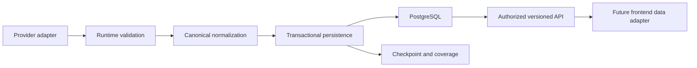
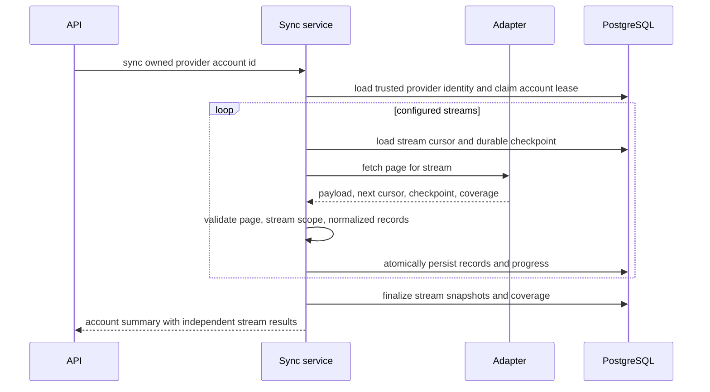

# Backend architecture

## Stack decisions

The backend is a TypeScript modular monolith. Fastify provides the HTTP lifecycle, request limits, JSON Schema validation, safe response serialization, and Pino logging. PostgreSQL stores canonical records and synchronization state. Drizzle supplies typed queries and versioned SQL migrations. Zod validates provider responses, and `decimal.js` validates decimal text before values reach PostgreSQL `NUMERIC(38,18)` columns.

Node.js 24 is pinned in CI and package metadata. Fastify 5 supports Node.js 20 and later. Fastify's schema validation operates on JSON Schema, and its logger supports redaction. Drizzle Kit generates SQL migrations that Drizzle applies from the migration folder. [Node.js releases](https://nodejs.org/en/about/previous-releases), [Fastify v5 migration guide](https://fastify.dev/docs/v5.8.x/Guides/Migration-Guide-V5/), [Fastify validation](https://fastify.dev/docs/latest/Reference/Validation-and-Serialization/), [Fastify logging](https://fastify.dev/docs/latest/Reference/Logging/), [Drizzle migrations](https://orm.drizzle.team/docs/migrations)

The stack keeps the existing TypeScript frontend on the same language and uses one relational database for ownership constraints and financial records. The current service does not calculate portfolio P&L. This avoids a competing accounting implementation while PR #1's `finance.ts` remains the source for frontend figures.

## Module boundaries

- `providers/` owns provider identity, capabilities, source parsing, and mapping to canonical records.
- `domain/` defines the normalized record union and exact decimal-string validation.
- `ingestion/` coordinates retries, account leases, page commits, source revisions, and coverage.
- `db/` owns PostgreSQL access, schema, and migration execution.
- `http/` owns the versioned API, request validation, principal resolution, ownership checks, and safe errors.

The configured registry contains the read-only `polymarket` public-wallet adapter and the `fixture-multisided` and `fixture-account-snapshot` test adapters. Polymarket-specific request and response mapping stays under `providers/polymarket/`; its normalized records still pass central validation and persistence.

## Canonical records

- A portfolio belongs to a user principal. Provider accounts are attached to portfolios and keep their provider-native account identifier separate from the principal.
- Provider events, markets, and outcome instruments keep provider-scoped external IDs. Markets can contain more than two outcomes. Cross-provider event relationships are stored separately with a review state that defaults to `unverified`.
- Fills, signed cash movements, settlements, positions, cash balances, price observations, and typed unreconciled provider activity facts are distinct records. Position snapshots identify whether the source reported them or they were reconstructed. Provider position status flags and source-reported value/P&L are stored separately from Scevia calculations. Reconciliation state is retained.
- Provider record identity is explicit: provider-native IDs are separate from Scevia composite source fingerprints. Exact sanitized-payload duplicates, unresolved financial rows, possible cross-endpoint overlaps, rejected rows, and excluded rows have separate outcomes and counters. An unresolved trade is retained as a minimal activity fact with financial values and provenance; it is not promoted to a canonical fill until metadata permits that mapping.
- Source records keep an adapter-selected, validated payload, a SHA-256 digest, retrieval time, normalization version, and source revision time when available. Superseded financial versions and stale market observations are retained in `source_record_revisions` with a revision type. Market and event revisions are compared independently: `sourceUpdatedAt` orders a market, while optional `eventSourceUpdatedAt` orders its event. If event-level ordering is absent, the market timestamp is used as a fallback. Provider-specific timestamp semantics still need verification.
- Coverage records are independent by provider account and entity. Observed record ranges do not imply that every record in the interval exists. Provider-confirmed start and end values are stored as outer bounds across reports; they do not establish continuity between disjoint intervals or prove lifetime completeness. Provider source-as-of, published snapshot watermark, latest attempt, and latest successful entity retrieval remain separate.

The schema does not assume binary markets, a fixed settlement amount, a universal asset, or a complete provider transaction history. Instrument payout values and collateral codes remain provider data. Event relationships are not inferred from title similarity.

## Financial integrity

Monetary amounts, fees, quantities, prices, payouts, and balances use PostgreSQL `NUMERIC(38,18)`. Adapters pass decimal strings. The runtime validator accepts at most 20 significant integer digits and 18 nonzero fractional digits; excess trailing zeroes are allowed because they do not change the value. No financial value passes through JavaScript `number` during normalization. API serialization returns decimal strings so callers do not silently round values.

Fees have both a nullable amount and a status. `unavailable` requires a null amount. `reported` and `estimated` require an amount. Negative fee values can represent rebates. A missing mark remains null. Cash movements use signed amounts, with deposits positive and withdrawals negative. All persisted timestamps use `timestamp with time zone` and normalized UTC ISO values. Original timestamps remain in the sanitized source payload for audit and replay.

The API returns source facts and coverage. It does not infer missing deposits, fill prices, fees, marks, or settlement outcomes, and it does not present partial activity as lifetime performance.

## Synchronization and recovery

The service reloads provider code and external account ID from the owned database row; caller-supplied identity fields are not trusted. One account-wide database lease prevents overlapping syncs, while each configured stream has its own checkpoint and run history. The lease expires after two minutes and is renewed before each page and transaction. Requests time out after at most ten seconds, retryable provider errors retry once with bounded backoff, and each account request stops after 25 seconds. That budget is divided across configured streams; durable cursors let a large history import advance in bounded batches while current positions and activity still receive a sync opportunity. Each committed page records upstream rows, source rows retained, invalid/excluded rows, persisted canonical records, exact duplicates, unresolved facts, and overlap candidates. A sync can advance its checkpoint after every received row has a persisted or explicitly counted outcome; entity coverage remains partial when data is unresolved or rejected.

Pagination cursor and durable provider checkpoint are different values. A committed page atomically stores its records, next pagination cursor, and any new durable checkpoint. An interrupted ordinary stream resumes at the last committed cursor. A stream declaring a complete authoritative position or cash snapshot must use `full_refresh`; after interruption, its old cursor is cleared atomically with the new run and the entire collection restarts from page one. This gives every publication one run ID across all pages without relying on provider pagination stability across attempts. Once a stream completes, its page cursor is cleared. Repeated cursor transitions, pages beyond 100, pages beyond 500 records, and streams beyond 10,000 records are rejected or stopped with safe error codes.

Stable account-scoped external IDs and unique indexes make financial activity ingestion idempotent. A legitimate fill correction updates the canonical financial row and preserves its previous source version. Market and event upserts each compare their own revision timestamps. An old event revision cannot overwrite newer event metadata or prevent a new market from being imported. A stale market revision does not replace that market or its instruments, but event metadata carried alongside it can still be accepted when its separate event timestamp is newer. If a provider supplies no usable revision timestamp, the stored revision is preserved when one exists; first-seen records can still be imported. These fallback rules need provider-specific validation.

Coverage stores observed record range, outer bounds of provider-reported intervals, provider source-as-of time, snapshot publication watermark, and attempt/success timestamps separately. The bounds are an envelope: reports for January–March and October–December produce outer bounds of January–December, but do not prove data exists from April through September. Observed record ranges are updated in the same transaction as the page and never use an event's future resolution date. An empty result can be complete only when the provider reports complete coverage. `lastSuccessfulSyncAt` advances only when the stream completed and that entity reported complete or partial availability; for a complete-snapshot entity it advances only when the snapshot was published. Unknown or unavailable reports leave the previous successful time unchanged. Interrupted attempts update last-attempt fields but preserve established coverage; an incomplete first import is partial only when it committed pages. Unsupported operations remain unavailable with `unsupported_by_provider`; a provider can separately report temporary unavailability.

Position and cash snapshot observations are retained per sync run. Rows from a full authoritative snapshot are not published as current until every page succeeds and the provider reports complete coverage for that entity. Finalization replaces the prior current set, including clearing it for a complete empty snapshot, and stores the snapshot's source-as-of watermark even when the result contains no rows. A stale complete snapshot cannot clear newer state. Partial snapshots leave the prior current set and watermark intact. Current-state evidence can establish an explicit zero. Historical Polymarket closures are activity facts. A later observation is current only if its timestamp is not older than the existing state or last complete snapshot watermark; a newer OPEN row can reopen it. Absence never closes an incremental holding. The positions API returns zero tombstones and last-known nonzero observations with `observationStatus` and `positionState`, distinguishing a latest successful refresh that observed the row from one that did not, an incomplete latest attempt, provider-reported zero/closed/redeemable/positive, and unknown. A missed row remains last-known data, not a confirmed current holding. Cash balances preserve explicit zero values.

## API and ownership

The REST contract is versioned under `/v1` and published as OpenAPI at `/docs`. Fastify JSON Schema validates route parameters and pagination. SQL is built through Drizzle's parameterized query APIs. Every private query joins through the owning portfolio and the authenticated principal. Out-of-scope portfolios and accounts return the same 404 response as absent resources.

The current development principal is selected by server configuration after a bearer token check. The server never accepts an owner ID from the client. It can create development portfolios and register explicitly entered Polymarket public wallets under an owned portfolio. Source registration normalizes the address and is idempotent within that portfolio. The fixed-token mechanism is unavailable in production, and the unimplemented external-auth mode fails closed. `GET /v1/providers`, public market search, supported-link resolution, and price history do not require a portfolio; stored portfolio records remain private.

## User data ownership and future product boundary

The current ownership chain is `users → portfolios → provider_accounts → source records and financial records`. A portfolio can contain multiple provider accounts, and a provider account is a data source rather than a Scevia identity. `provider_accounts.kind` includes `file_import` as a type boundary, but there is no CSV importer, production login, provider connection flow, credential store, market catalog endpoint, export endpoint, or user-facing disconnect/delete operation. The development principal is fixed by server configuration. Ownership-scoped queries and database cascades are present, but they do not replace production authentication or an end-user lifecycle API.

The backend persists user-linked financial observations and sanitized source payloads in PostgreSQL. Those payloads are plaintext to the backend service and database operators; encryption at rest is a deployment control and is not end-to-end encryption. API responses omit raw payloads and provider account identifiers. No provider credentials are stored today. There is no configured retention period or payload expiry, so source payloads and their revisions persist until their rows are deleted. User export and user-facing deletion workflows are also absent. Deleting a user row cascades through portfolios, source accounts, source records, revisions, and financial records; shared provider events, markets, instruments, and other public metadata may remain. Price observations are currently attached to a provider account; a globally shared public-price cache would need separate design and provider-term review. This describes current implementation, not a complete privacy guarantee.

The intended product direction is to process portfolio data for the functionality a user explicitly selects and not repurpose it for advertising, resale, AI training, or unrelated commercial use. These are product principles, not yet an enforced production policy or technical guarantee. A later retention policy should keep normalized financial history and the minimum provenance needed for user-requested tracking while giving temporary ingestion payloads and operational data an explicit expiry. Any retained original file should have a defined user purpose and retention window. Before real multi-user cloud use, define retention by data class, secure operational logs and backups, add principal authentication and authorization, and implement source disconnection, portable export, deletion, and revocation. Disconnecting a source should stop future sync; deleting a source should separately specify whether imported history is retained or erased. User deletion must also cover saved scenarios and private settings added later. The current Polymarket Terms of Use also require legal review for any proposed public or commercial use of API data.

Future sources should remain independent and attributable: public wallet tracking, appropriately scoped authenticated read-only accounts, and CSV or other file imports can each use the existing provider-account/adapter/canonical-record boundary. A public wallet address is an identifier, not proof of ownership. Provider signing credentials are distinct from wallet keys and must not have trading or withdrawal permissions. A future importer should normalize into the same financial model, track import-batch provenance, bound file and row sizes, avoid retaining original files without a defined need, and reconcile API/import overlap only when identity evidence is reliable. The schema does not yet include import batches or reconciliation policy.

Events, markets, and instruments are keyed by provider-native identities and can be persisted independently of private portfolio records. Market and event updates use separate revision timestamps and preserve known fields when an incoming observation is partial; lower-confidence event identity does not silently reassign a market. Polymarket event ID, event slug, market ID, condition ID, outcome instrument ID, and version-specific position/CLOB token IDs are distinct. The stateless public market search pages through Gamma with an explicit event/market cap, next-page state, enrichment errors and truncation flags. Supported-link resolution accepts only Polymarket event/market paths and known tracking parameters, then calls trusted Gamma/CLOB APIs; it does not fetch arbitrary URLs. Structured market fee facts and version-aware outcome IDs are exposed for a later frontend handoff. Scenario positions should be stored as hypothetical records in a separate future scenario model, apart from provider holdings and synchronization state; no scenario persistence or simulation engine exists here.

## Security controls and remaining work

| Asset or boundary | Current control | Remaining work before production |
|---|---|---|
| Portfolio and account data | Principal-scoped database queries, UUID ownership links, private routes require bearer authentication | Integrate a maintained OIDC or equivalent principal resolver, user sessions, and security review |
| Development token | Constant-time digest comparison, token redaction, fixed principal from environment | Replace with production identity and managed secrets |
| Provider requests | Fixed Polymarket Data API, Gamma, and CLOB hosts; URL slug allowlist; redirects rejected; 8 second timeout; 2 MB response limit; central stream/record validation | Confirm terms and operational limits before public/commercial deployment; add provider-aware monitoring and production egress controls |
| Database records | Parameterized queries, foreign keys, unique external IDs, numeric checks, transactions | Separate migration and application roles, validate backup restoration, and configure managed encryption and rotation |
| HTTP service | 256 KB request body limit, 30 second request timeout, allowlisted CORS, 100 requests per minute globally, five sync requests per minute | Configure trusted proxy hops and production edge limits with the deployment platform |
| Logs and source payloads | Authorization header redaction, safe API errors, adapter-selected payload fields, sensitive-key rejection as defense in depth, 64 KB raw-record cap | Set production retention, access, audit, and data deletion procedures |

The local Compose service binds PostgreSQL to loopback. The app does not store provider credentials or expose trading operations. The repository does not yet have a production authentication provider, secret manager, deployed service, backup automation, or an end-user deletion endpoint. Deleting a user row cascades through that user's portfolio, provider accounts, source records, and financial data. Shared provider market metadata can remain after portfolio deletion.

## Local data operations

The Compose volume persists PostgreSQL data across container restarts. A local backup can be made with `docker compose exec -T postgres pg_dump -U scevia scevia > scevia-backup.sql`. Restore into a fresh local database with `cat scevia-backup.sql | docker compose exec -T postgres psql -U scevia -d scevia`.

Keep `.env` files and database backups out of Git. A production deployment must set an explicit retention period, restrict backup access, test restoration, and define deletion behavior before storing user-linked real provider data.

The test runner starts an isolated PGlite instance by default. An external destructive-test database requires an explicit opt-in, a loopback PostgreSQL host, and a database name ending in `_test`. Fixture seeding is blocked in production and limited to a local `scevia` or `scevia_test` database unless a developer explicitly allows a `_dev` target.

## Phase 2 Polymarket implementation and reconciliation boundary

The Phase 2 adapter uses Data API v2 for OPEN and CLOSED positions, trades, activity and token metadata; Gamma for paginated public search and event/market details; CLOB `/midpoints` for a current reference midpoint; and Data API v2 price history for public, non-persisted history. Source mapping, endpoint parameters, automated evidence and remaining limitations are detailed in [POLYMARKET.md](POLYMARKET.md).

Positions are partial incremental observations because no stable authoritative snapshot/as-of contract was verified. OPEN refreshes restart following interruption and determine current position membership. CLOSED backfill runs independently. Absence only changes API freshness to not-seen-after-latest-success; incomplete refreshes remain distinct. Trades and activity use independent durable cursors and timestamp overlap. Composite source fingerprints are not provider-native IDs; exact source duplicates and cross-endpoint overlap candidates are classified separately, while ambiguous same-transaction rows remain a reconciliation limitation. Missing trade metadata creates retained unresolved facts rather than dropping retrieved financial values. Gamma market fees are structured estimates for future hypothetical trades; actual historical trade fees remain unavailable. Deposits/withdrawals are signed provider activity observations; other events such as redemptions, merges, splits and rewards stay unreconciled facts. No lifetime P&L is calculated.

The provider client uses fixed hosts, bounded response sizes and timeouts, and rejects redirects. A limited official example-wallet query returned empty envelopes; it did not validate live populated records. A local-only script distinguishes connectivity, populated ingestion, repeat deduplication and public market services, and requires explicit authorization attestation before wallet modes. It was not run in this change because the applicable provider-use authorization and Scevia classification are unresolved. The current Terms of Use require maintainer/legal review and any required written permission before populated development validation or public/commercial use. Phase 3 must reconcile activity across streams, source-fingerprint collisions and corrections, overlap candidates, redemption/settlement evidence, historical fee limitations, collateral-asset semantics, and positions against fills before publishing realized performance.

Activity fact occurrences join one fact to one sync run. The count and cursor commit in one transaction, so an interrupted backfill preserves committed observations without accumulating overlap into one lifetime count. Legacy activity facts have no retroactive occurrence count. A fact's payload is the current stored observation; counts describe the attempt and are not a copy of each historical payload revision.

Phase 3 adds a source-independent import and replay path. Confirmed CSV evidence, economic identity groups, accounting effects and derived portfolio state are separate surfaces. See [Accounting](ACCOUNTING.md) for event ordering, ownership, corrections and coverage.

Accounting reads a consistent portfolio evidence window from confirmed CSV batches and stored provider records. It scopes identity to the financial account and retains source record digests and import row references. Current positions, cash snapshots and timestamped marks remain evidence rather than trade substitutes. See [Accounting](ACCOUNTING.md) for replay rules, opening assumptions and the limits of provider reconciliation.

Phase 3 portfolio decisions are a separate append-only overlay keyed by stable import row or provider source identity. Review digests bind a bounded change set to current affected evidence. Adjustments preserve original financial evidence and make the selected portfolio distinct from the complete external account.

The portfolio overlay composes membership, financial values, accepted identity and duplicate links independently. Duplicate links validate the effective target revision. Batch replacement previews reconcile prior decisions against unique stable row identities, and the reviewed decision transfer commits in the same transaction as replacement. Manual records keep their original stable keys under an independent capacity limit.

Phase 4 analytics are scoped read models over Phase 3 replay. Return calculations and reviewed settlement enumeration are reusable pure modules. See [Analytics](ANALYTICS.md) for financial eligibility and workload bounds.

Phase 4 exposes separate revisions for selected accounting evidence, provider coverage, snapshots, current catalog and reviewed settlement inputs. Phase 5 can freeze the scope and revisions of a baseline and reuse the pure analytics functions with isolated scenario inputs. See [Phase 4 methodology](ANALYTICS.md).

Phase 5 stores portfolio-owned scenario inputs with immutable normalized baselines and optimistic revisions. Its pure simulator applies hypothetical trades outside the actual ledger. Reviewed and conditional exposure reuse the Phase 4 settlement solver. See [Scenario calculation and persistence](SCENARIOS.md).

Scenario hardening separates instrument identity from conditional payout authority. Scenario-only funding buckets and resolved operation changes remain revisioned inputs. Baseline preview tokens pin the exact frozen evidence returned to the client.

Phase 6 extends the registry and ingestion pipeline with the restricted Kalshi adapter. It reuses canonical records, source revisions, snapshot publication, ownership, accounting replay and the component settlement solver. [Kalshi integration](KALSHI.md)
